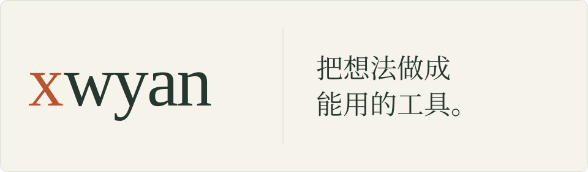

<picture>
  <source media="(prefers-color-scheme: dark) and (max-width: 600px)" srcset="./assets/banner-mobile-dark.svg">
  <source media="(max-width: 600px)" srcset="./assets/banner-mobile-light.svg">
  <source media="(prefers-color-scheme: dark)" srcset="./assets/banner-dark.svg">
  
</picture>

你好，我是 **xwyan**，在北京。  
关注 AI 工具、数据分析与工程实践。这里放公开项目，也留一些练习。

## 本地外呼数据分析

[**baitiao-ivr-dashboard**](https://github.com/xinglabs/baitiao-ivr-dashboard)

用 Python 和 Streamlit 做的分析面板，用来查看重呼、意向标签和话术改进线索。数据在本地处理，仓库不含业务数据。

---

**小练习**　[lianxi](https://github.com/xinglabs/lianxi) 是一个练习用的仓库。

[查看全部公开仓库](https://github.com/xinglabs?tab=repositories)
